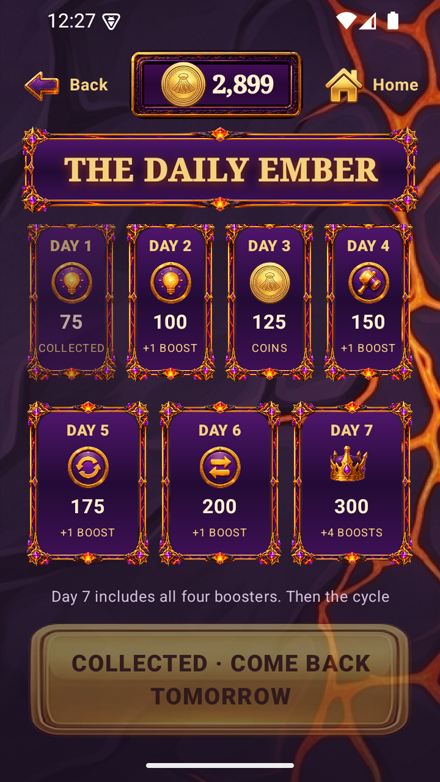
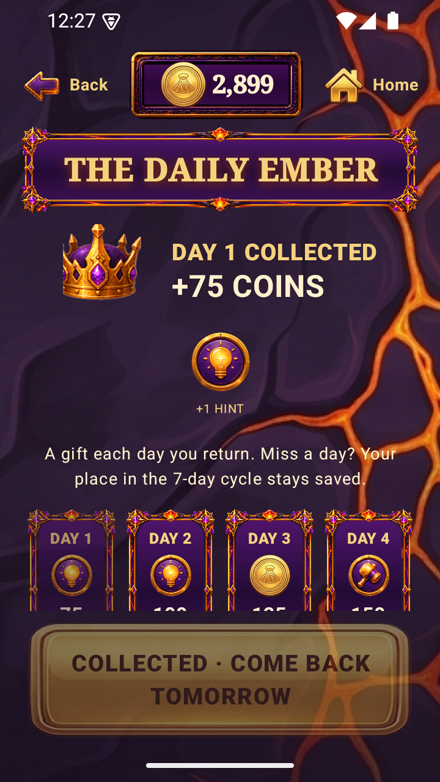
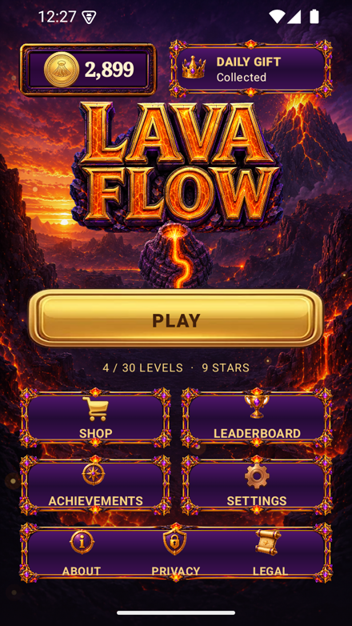

# Lava Flow

A volcanic pipe-rotation puzzle: tap tiles to rotate them and route molten lava from a fixed source to the goal portal before you run out of moves.

Tapping a straight, corner or T-junction tile rotates it 90 degrees clockwise; a reciprocal BFS pathfinder determines which tiles are lava-reachable in real time, and a full connection locks input while the winning route animates before the level settles. 30 hand-designed boards (5x5 growing to 6x6) tighten move budgets and route complexity as you progress, backed by four strategic boosters, a star/coin economy, daily rewards and achievements, all wrapped in a purple-and-gold volcanic presentation.

## Screenshots

<p align="center">
  
  
  
  
</p>

## Features

- Tap-to-rotate pipe-routing puzzle with real BFS pathfinding for source-to-goal connectivity
- 30 explicit, hand-designed levels (5x5 for levels 1-12, 6x6 for 13-30) with per-level move/star thresholds
- Four strategic boosters — Hammer (clear a blocked cell), Auto Rotate, Hint, and Swap — each atomic and moves-free
- Star and coin economy with a shop, daily rewards, and achievements
- Distinct win/lose presentation, including a unique "Master of the Flow" finale on level 30
- Deterministic core (graph/round/profile/economy logic) fully separated from the Compose presentation layer
- Debug and release build variants with separate application IDs and save data

## Tech Stack

- **Language:** Kotlin
- **Platform:** Android (minSdk 26, targetSdk 35)
- **Engine / framework:** Jetpack Compose
- **Build:** Gradle (Kotlin DSL), split into `app` and `core` modules

## Project Structure

```
app/                  # Compose UI, navigation, Android persistence and feedback
core/                 # Pure Kotlin puzzle graph, round logic, profile, economy, level catalog
docs/shots/           # Screenshots
```

## Building

```bash
git clone https://github.com/brah1995u/lava-flow-android.git
cd lava-flow-android
./gradlew :app:assembleDebug
```

The APK lands in `app/build/outputs/apk/debug/`.

## Status

Feature-complete: all 30 levels, all four boosters, the full economy/reward loop and complete visual presentation are implemented and shipped as both a debug-signed and an optimized release APK, verified through automated tests and emulator QA scripts.

## License

© 2026 Andrii (Cortex Studio). All rights reserved. The source is published as a portfolio sample.
